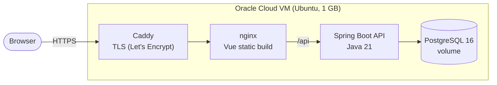
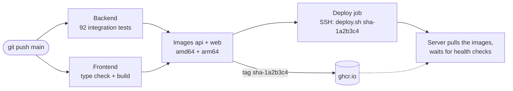

# ⚽ Torneo de Exalumnos · Colegio Marianista

[](https://github.com/smalirat/torneo-exalumnos/actions/workflows/ci.yml)
[](https://torneo-marianista-demo.duckdns.org)

A web app to run a real amateur football league (the alumni league of Colegio Marianista, Buenos Aires): fixtures,
results, standings, top scorers, sanctions and team rosters, with a public site for players and panels for the
organizer and the team captains. Built and operated end to end: Spring Boot + Vue, containerized, tested and deployed
automatically to a free cloud server on every push.

**Live demo:** https://torneo-marianista-demo.duckdns.org

### Try it

The demo runs a full season with **fictional data**: every team and player name is invented (generated from the
league's real workbook, so results, rules and structure are real). You can log in and change anything; the database
goes back to a clean copy every night.

| Role | Username | Password | What you can do |
|---|---|---|---|
| Organizer (admin) | `demo` | `probar-la-demo` | Editions, fixtures, results, Excel import/export, approvals, sanctions, banned list |
| Captain · Defensores de Lapacho (Clausura, Cat. A) | `cap.defensores-de-lapacho` | `probar-la-demo` | The team's roster, crest, player changes, protests |
| Captain · Central Ceibo (Clausura, Cat. B) | `cap.central-ceibo` | `probar-la-demo` | Same, for another team (and no access to the first one) |
| Captain · Estrella Aromo (Apertura) | `cap.estrella-aromo` | `probar-la-demo` | Same |

Log in at [/ingresar](https://torneo-marianista-demo.duckdns.org/ingresar).

---

## The problem

The league has run on Excel spreadsheets for years: one workbook per season, results typed by hand, standings computed
with formulas, sanctions tracked in a separate sheet and shared as screenshots in WhatsApp groups. The rulebook has
details that are easy to get wrong by hand: head-to-head tiebreakers, a presence point, forfeits counted as 3-0,
suspensions that follow the player across tournaments, roster limits, players that can only play from a given match day.

The goal: one source of truth that applies the rules, that the organizer can keep loading the way they already work
(the Excel import/export stays), and that anyone can check from a phone.

## What it does

- **Public site:** results by match day, standings per zone, top scorers, booked and suspended players, playoffs and
  finals, team pages and rosters. Followers get notified of new fixtures and results.
- **Captains:** register their team, manage the roster (with the league's DNI ban list and roster limits), see
  their matches and file protests.
- **Organizer (admin):** editions (Apertura / Clausura) with categories and zones, random zone draw, round-robin and
  interzonal fixture generation, automatic build of a new edition from the previous one (promotions, relegations,
  vacancies), results entered per player (goals, cards, who played), sanctions offered after a red card, suspended
  and swapped matches, protests, and Excel import/export of a whole season.
- **League rules in code:** 3/1/0 plus a presence point, head-to-head mini-league tiebreak → goal difference → goals
  for → wins → presence, forfeits (one or both teams absent), sanctions carried over between seasons, transfers with
  one team per edition. See [`docs/modelo-campeonato.md`](docs/modelo-campeonato.md).

## Architecture



The app is four containers on one machine, started by Docker Compose, plus three for monitoring:

| Container | Role | Exposed |
|---|---|---|
| **caddy** | HTTPS: gets and renews the Let's Encrypt certificate, redirects HTTP → HTTPS | 80, 443 (the only open ports) |
| **web** | nginx serves the Vue build (SPA fallback, cached hashed assets, security headers) and proxies `/api` to the backend, so there is no CORS | internal |
| **api** | Spring Boot REST API, JWT auth, Flyway migrations on startup | internal |
| **db** | PostgreSQL with a named volume; nightly compressed dumps | internal |
| **prometheus**, **node-exporter**, **grafana** | Metrics of the app (Actuator) and the server, 30 days kept, one provisioned dashboard | `127.0.0.1` only (SSH tunnel) |

## Delivery pipeline



Every push to `main` that passes the tests is live a few minutes later; a pull request runs the same checks and
builds the images without publishing them.

- **Build once, deploy many:** the server never compiles. It runs exactly the images that passed CI, tagged with the
  commit (`sha-1a2b3c4`), so a rollback is `./deploy.sh <previous tag>`.
- **A deploy that fails says so:** `docker compose up --wait` waits for every health check, and the job turns red if
  the new version does not come up healthy.
- **The CI's SSH key can only deploy:** in `authorized_keys` it is bound to a forced command
  ([`deploy/deploy-ci.sh`](deploy/deploy-ci.sh)) that accepts nothing but an image tag. A leaked key can deploy a
  version CI built, and nothing else: no shell, no reading secrets.
- **Pinned host key:** the job verifies the server's SSH fingerprint instead of disabling host key checking.
- **Least privilege:** the workflow only reads the code; only the image job can write packages; secrets live in
  GitHub (the private key as an encrypted secret, host and fingerprint as plain variables).

## Infrastructure and operations

- **Oracle Cloud Always Free**, São Paulo. The ARM shape (4 OCPU / 24 GB) had no capacity for days, so the demo runs
  on the 1 GB AMD micro. The images are multi-arch, so moving to ARM later needs no change. The instance and its network
  can be created with [`infra/oci_launch.py`](infra/oci_launch.py) (OCI Python SDK), which retries until there is
  capacity.
- **Fitting in 1 GB:** Java capped at 256 MB heap (serial GC, C1 only), 2 GB of swap with low swappiness, rotated
  container logs (3 × 10 MB), longer health check start period for the small CPU. Idle footprint: API ~180 MB,
  Postgres ~25 MB, Caddy ~14 MB, nginx ~8 MB.
- **Hardening:** two firewalls (OCI security list and iptables) with only 22, 80 and 443 open; SSH keys only, no root
  login; fail2ban; unattended security upgrades; database and API not reachable from outside; Swagger disabled.
- **Security in layers** ([`docs/security.md`](docs/security.md)):
  - *app:* parameterized queries only; size and format limits on every input; invisible characters stripped;
    uploaded images re-encoded (no EXIF/GPS, no hidden payloads, decompression bombs refused); forged JWTs rejected;
    tests that sweep every public endpoint for DNI, email or phone.
  - *edge:* per-IP rate limits that a spoofed `X-Forwarded-For` cannot bypass; strict CSP; HSTS; self-hosted fonts.
  - *containers:* nothing runs as root (nginx included), all Linux capabilities dropped, read-only filesystems,
    process limits, and segmented networks where the database and the API have no internet access.
  - *data:* the off-site backup copy is encrypted with a public key whose private half never touches the server.
  - *supply chain:* Trivy scans the images and the container config, CodeQL scans the code, Dependabot opens weekly
    updates. The first scan found 60 high/critical CVEs in an outdated nginx base image; both images are at 0 now.
- **Backups:** nightly `pg_dump` (cron, 04:00 Argentina), compressed, written atomically, 14 days kept on the
  server and copied to Oracle Object Storage through a **write-only** pre-authenticated URL (it cannot list, read or
  delete). The bucket has a 30-day retention rule, so not even that URL can overwrite a backup, and a lifecycle rule
  that deletes them after 90 days. [`restore.sh`](deploy/restore.sh) tested by deleting data and restoring it.
- **Observability:** Spring Boot Actuator + Micrometer expose JVM, HTTP and connection-pool metrics on a separate
  port that nginx never forwards; node-exporter adds CPU (including steal on the shared micro), RAM, swap and disk.
  Prometheus keeps 30 days, Grafana shows a dashboard provisioned from git. Both listen on `127.0.0.1` only and are
  reached through an SSH tunnel; all three have memory caps (~130 MB together at idle).
- **Alerts:** a scheduled GitHub Actions workflow checks the site, the API and the certificate's expiry every 10
  minutes from outside Oracle and emails on failure; the nightly backup reports to healthchecks.io, which emails when
  a night's report does not arrive (a dead man's switch).

Step-by-step: [`docs/deploy.md`](docs/deploy.md), [`docs/observability.md`](docs/observability.md).

## Decisions and trade-offs

| Decision | Why | Trade-off |
|---|---|---|
| One VM with Docker Compose, not Kubernetes or a PaaS | A league app with a few hundred users; free tier; everything visible and debuggable | No high availability: if the VM goes down, the site goes down |
| PostgreSQL in the same VM | Self-contained demo, backups under my control, no external dependency | Shares 1 GB with the app; a managed database would scale and back up by itself |
| Caddy in front of nginx | Automatic HTTPS and renewal in 3 lines; nginx keeps doing what it already did well | One more container (~14 MB) |
| Images built in CI, pulled by the server | Reproducible deploys, instant rollbacks, no build tools on the server | Needs a registry and a tag strategy |
| Multi-arch images (amd64 + arm64) | Same images on the AMD micro, the ARM free tier or a laptop | Slower image builds (QEMU), offset by building the jar once on the native platform |
| SSH deploy with a forced command | Simple push-based CD without an agent on the server, with the key limited to one action | Port 22 stays open to the internet (next step: Tailscale) |
| Flyway migrations, H2 in PostgreSQL mode for tests | Same schema everywhere; tests need no database or secrets, so CI is simple | A few PostgreSQL-only features cannot be used |

## Problems found along the way

- **A healthy container reported unhealthy.** The web health check called `http://localhost/`; inside the container
  `localhost` resolved to `::1` first and nginx only listens on IPv4. Found from the health check log
  (`docker inspect … .State.Health`), fixed with `127.0.0.1`. `--wait` stopped that deploy instead of declaring it done.
- **fail2ban watching the wrong service.** Its SSH filter reads the journal of `sshd.service`; on Ubuntu 24.04 the unit
  is `ssh.service`, so it would never have banned anyone. Tested the filter against the real failed logins (15 in the
  first two hours of the VM's life) and pointed it at the right unit.
- **An empty crontab.** `set -e` stopped the subshell when `grep` found nothing in the empty crontab, so the backup line
  was never added. Caught by reading the crontab back.
- **502 after the API moved.** While testing the monitoring stack, the site answered 502 although every container was
  healthy. nginx resolves `proxy_pass http://api:8081` once, at startup; the API container had been recreated with a
  new IP and nginx kept the old one. In production that happens on any deploy where the web image does not change (so
  Docker does not recreate it); it had not bitten yet only because Docker happened to hand the same IP back.
  Fixed by resolving through Docker's DNS on each request (`resolver 127.0.0.11` + a variable in `proxy_pass`), and
  verified by forcing the API onto a different IP.
- **A deploy that took the whole site down.** The deploy that added Prometheus and Grafana started them together with
  the new API; on the shared micro CPU the API took 431 s to start instead of ~130 s, failed its health check window,
  and the web container (which waited for a *healthy* API) never started: the job went red and the site answered 502.
  The new dashboard showed why: **56% CPU steal**, time the cloud host gives to other VMs. Fixed by making the web
  depend on the API being *started*, not healthy (possible after the nginx DNS fix): now a slow API only delays
  `/api`, the site keeps loading; and a longer start window. Re-tested: home page 200 during the whole restart.
- **Old images filling the disk.** `docker image prune` only removes untagged images; every deployed version kept its
  tag. Switched to `prune -a` (435 MB freed on the first run).
- **A missing CI variable.** The deploy failed in under a second with `Could not resolve hostname`: the variable had a
  different name than the workflow expected. The job now checks its secrets and variables and says which one is missing.
- **No ARM capacity.** The console kept answering "Out of capacity", so the instance creation became a small script
  against the OCI API that retries every minute, in every availability domain, without pinning a fault domain.

## Tech stack

| Layer | Technology |
|---|---|
| Backend | Java 21, Spring Boot 3.5, Spring Security (JWT), JPA/Hibernate, Flyway, Apache POI (Excel), springdoc OpenAPI |
| Frontend | Vue 3, TypeScript, Vite, Vue Router |
| Data | PostgreSQL 16 (H2 in PostgreSQL mode for tests) |
| Containers | Docker multi-stage builds (non-root, health checks), Docker Compose, nginx, Caddy |
| Observability | Spring Boot Actuator, Micrometer, Prometheus, node-exporter, Grafana |
| CI/CD | GitHub Actions, GitHub Container Registry, Buildx + QEMU (multi-arch) |
| Security | Trivy (image CVEs and container config), CodeQL, Dependabot, GnuPG (backup encryption) |
| Cloud | Oracle Cloud Infrastructure (VCN, security lists, compute, Object Storage, IAM), OCI Python SDK, DuckDNS |
| Operations | Ubuntu 24.04, iptables, fail2ban, unattended-upgrades, cron, swap tuning |

## Run it locally

With Docker (the whole app, same images as production but built locally):

```bash
cp .env.example .env          # set DB_PASSWORD, APP_JWT_SECRET (32+ chars) and APP_ADMIN_PASSWORD
docker compose up -d --build  # http://localhost:8080
```

For development (hot reload):

```bash
./mvnw spring-boot:run -Dspring-boot.run.profiles=dev   # API on :8081, in-memory H2, admin/admin123
cd frontend && npm install && npm run dev               # http://localhost:5173
./mvnw test                                             # 92 tests, no database needed
```

With the `dev` profile Swagger UI is at http://localhost:8081/swagger-ui.html. Configuration and database details:
[`docs/docker.md`](docs/docker.md), [`docs/base-de-datos.md`](docs/base-de-datos.md).

## Repository

```
src/main/java/…          Spring Boot API: controller/, service/, entire/ (entities), repo/, security/, dto/, excel/
src/main/resources/db/   Flyway migrations (V1–V21)
src/test/                Integration tests (H2)
frontend/                Vue 3 + TypeScript app, its Dockerfile and nginx config
Dockerfile               API image (Maven build stage → JRE 21 Alpine, non-root)
docker-compose.yml       Local stack (builds the images)
deploy/                  Production: compose with published images, Caddyfile, deploy/backup/restore scripts
deploy/monitoring/       Prometheus config, Grafana data source and dashboard
infra/                   OCI scripts: instance + network, backup bucket
.github/workflows/       CI/CD
docs/                    Design notes and guides (Spanish)
```

| Doc | Content |
|---|---|
| [`docs/modelo-campeonato.md`](docs/modelo-campeonato.md) | Tournament model and league rules |
| [`docs/excel-y-temporadas.md`](docs/excel-y-temporadas.md) | Excel import/export and seasons |
| [`docs/docker.md`](docs/docker.md) | Local Docker stack |
| [`docs/ci.md`](docs/ci.md) | CI/CD workflow |
| [`docs/deploy.md`](docs/deploy.md) | Server setup, deploys, rollbacks, backups |
| [`docs/observability.md`](docs/observability.md) | Metrics, dashboard, SSH tunnel |
| [`docs/security.md`](docs/security.md) | Security layers, backup encryption key, what is left |

## What's next

- **Real use:** the league running the season on the app.
- **Spring Boot 4:** the 3.5 line no longer gets free patches (two Spring Framework CVEs are fixed only in 7.x; neither applies today).
- **Metric alerts:** Grafana alerts by email (memory, 5xx, response time).
- **Centralized logs:** Loki, if memory allows.
- **Close port 22:** SSH only over Tailscale, for me and for the CI.
- **Config in the pipeline:** today a deploy changes images only; changes to `deploy/` are copied by hand.
- **ARM instance:** move to the 4 OCPU / 24 GB free shape when capacity shows up (backup → restore → DNS).
